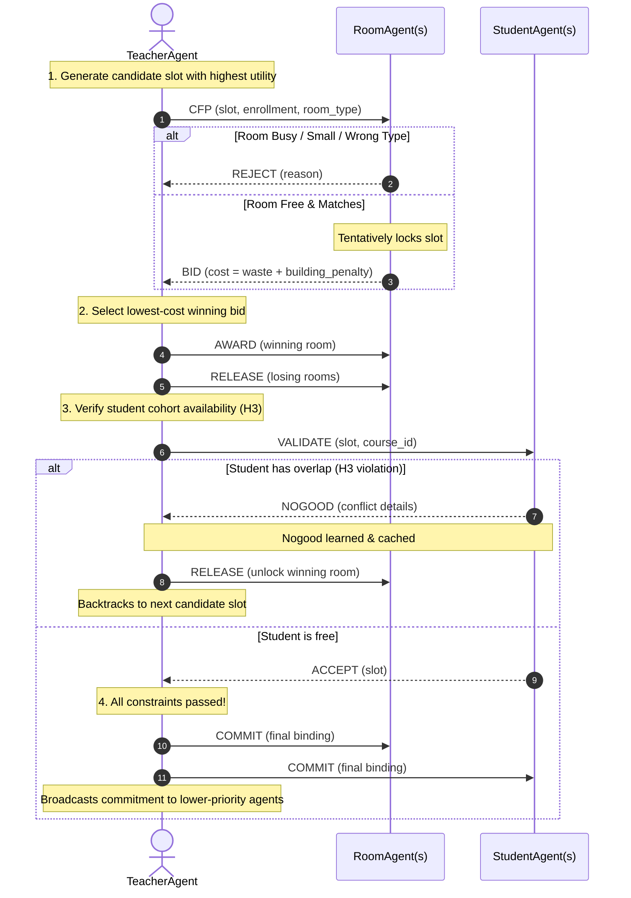

# Autonomous Academic Timetabling System
## Comprehensive Product Architecture, Multi-Agent Flow & Faculty Evaluation Master Guide

---

> **Course:** Fundamentals of Artificial Intelligence (Semester 7)  
> **Topic:** Distributed Constraint Satisfaction Problem (DisCSP) & Multi-Agent Systems (MAS)  
> **Team Reference:** Complete Technical Documentation, Agent Communication Protocols, Code Walkthrough & Faculty Viva Defense Guide  

---

## Table of Contents
1. [Executive Summary & Problem Statement](#1-executive-summary--problem-statement)
2. [Why Multi-Agent Systems? (MAS vs. Centralized Solvers)](#2-why-multi-agent-systems-mas-vs-centralized-solvers)
3. [Technology Stack & Architectural Principles](#3-technology-stack--architectural-principles)
4. [Repository File & Directory Structure](#4-repository-file--directory-structure)
5. [Core Data Models & Enums (`models.py`)](#5-core-data-models--enums-modelspy)
6. [Agent Taxonomy & Internal Logic (`agents.py`)](#6-agent-taxonomy--internal-logic-agentspy)
   - [RoomAgent](#61-roomagent)
   - [StudentAgent](#62-studentagent)
   - [TeacherAgent](#63-teacheragent)
7. [Multi-Agent Communication & Negotiation Protocols](#7-multi-agent-communication--negotiation-protocols)
   - [Contract Net Protocol (CNP)](#71-contract-net-protocol-cnp)
   - [Asynchronous Backtracking (ABT) & Nogood Learning](#72-asynchronous-backtracking-abt--nogood-learning)
   - [The Canonical Conflict Resolution Sequence (CSE401 Walkthrough)](#73-the-canonical-conflict-resolution-sequence-cse401-walkthrough)
8. [Constraint Engine & Formulation (`constraints.py`)](#8-constraint-engine--formulation-constraintspy)
   - [Hard Constraints (H1 – H6)](#81-hard-constraints-h1--h6)
   - [Soft Constraints & Utility Function (S1 – S3)](#82-soft-constraints--utility-function-s1--s3)
9. [Simulation Engine & Orchestrator (`scheduler.py`)](#9-simulation-engine--orchestrator-schedulerpy)
10. [User Interface & Simulation Studio (`app.py`)](#10-user-interface--simulation-studio-apppy)
11. [Verification & Automated Test Suite (`test_scheduling.py`)](#11-verification--automated-test-suite-test_schedulingpy)
12. [Faculty Evaluation & Viva Defense Cheat Sheet](#12-faculty-evaluation--viva-defense-cheat-sheet)
13. [Team Presentation Playbook (5-Min, 10-Min, and Live Demo Scripts)](#13-team-presentation-playbook)

---

## 1. Executive Summary & Problem Statement

### 1.1 The Academic Timetabling Challenge
University course timetabling is a classic **combinatorial optimization problem** proven to be **NP-hard**. In any real university department, creating a conflict-free, high-quality timetable requires mapping hundreds of course sessions to finite sets of:
- **Time Slots:** Days (Monday–Friday) $\times$ Periods (P1–P8) = 40 discrete slots.
- **Physical Rooms:** Lecture halls, specialized labs, each with fixed seating capacity and campus locations.
- **Instructors:** Faculty members with individual availability, workload constraints, and time preferences.
- **Student Cohorts:** Student groups enrolled in combinations of core and elective courses whose schedules must never overlap.

### 1.2 Mathematical Formulation
Let:
- $\mathcal{S} = \{s_1, s_2, \dots, s_n\}$ be the set of course sessions to schedule.
- $\mathcal{T} = \{\text{Monday}, \dots, \text{Friday}\} \times \{\text{P1}, \dots, \text{P8}\}$ be the set of 40 atomic time slots.
- $\mathcal{R} = \{r_1, r_2, \dots, r_m\}$ be the set of rooms with capacities $C(r)$ and types $T(r) \in \{\text{Lecture}, \text{Lab}\}$.
- $\mathcal{F} = \{f_1, f_2, \dots, f_k\}$ be the set of faculty members.
- $\mathcal{G} = \{g_1, g_2, \dots, g_p\}$ be the student cohorts with course enrollment sets $E(g) \subseteq \mathcal{S}$.

Each session $s_i$ requires an assignment:
$$x_i = (t_i, r_i) \in \mathcal{T} \times \mathcal{R}$$

The objective is to find a complete assignment $\mathbf{X} = \{x_1, \dots, x_n\}$ such that **all hard constraints (H1–H6) are strictly satisfied** ($\text{Violations} = 0$), while maximizing global faculty and institutional satisfaction (soft utility scores).

---

## 2. Why Multi-Agent Systems? (MAS vs. Centralized Solvers)

During faculty evaluation, the first question examiners often ask is:  
*“Why not just use an Integer Linear Programming (ILP) solver or a centralized Genetic Algorithm?”*

Here is the exact comparison your team should present:

| Feature | Centralized Approach (ILP / CSP Solver) | Multi-Agent Approach (Our Product) |
|---|---|---|
| **Privacy Preservation** | Requires a central authority to know every teacher's private preferences, medical leaves, and internal constraints. | **Decentralized & Private:** Faculty agents keep their utility functions and availability private, exposing only proposals and bids. |
| **Dynamic Re-scheduling** | A single faculty change or room closure requires rerunning the entire matrix from scratch ($O(N!)$ re-computation). | **Local Negotiation:** Affected agents renegotiate locally without disrupting the global timetable. |
| **Realistic Organizational Modeling** | Treats human departments as static mathematical matrices. | **Models Real Academics:** Simulates real department heads, instructors, and room managers negotiating over resources. |
| **Scalability & Bottlenecks** | Single point of failure; memory consumption explodes exponentially with $N$. | Distributed decision-making; agents operate asynchronously using bounded message passing. |
| **Explainability** | Produces a "black-box" final matrix with no clear audit trail of why a slot was assigned. | **Complete Audit Trail:** Every assignment has an explicit negotiation log (`CFP` $\to$ `BID` $\to$ `AWARD` $\to$ `VALIDATE` $\to$ `COMMIT`). |

---

## 3. Technology Stack & Architectural Principles

```
┌─────────────────────────────────────────────────────────────────────────┐
│                           PRESENTATION LAYER                            │
│           Streamlit 1.32+  •  Custom Cream & Burgundy Design System     │
│             Real-Time Telemetry  •  Interactive Scenario Studio         │
└────────────────────────────────────┬────────────────────────────────────┘
                                     │ Session State
┌────────────────────────────────────▼────────────────────────────────────┐
│                           SIMULATION LAYER                              │
│         scheduler.py (Orchestrator, Priority Queue, Stats Engine)       │
└──────────────────┬───────────────────────────────────┬──────────────────┘
                   │ Message Dispatch                  │ Independent Check
┌──────────────────▼──────────────────┐ ┌──────────────▼──────────────────┐
│          MULTI-AGENT LAYER          │ │       VALIDATION ENGINE         │
│             agents.py               │ │        constraints.py           │
│  • TeacherAgent (CNP Initiator, ABT)│ │  • Standalone H1–H6 Validator   │
│  • RoomAgent (CNP Participant)      │ │  • Zero agent dependencies      │
│  • StudentAgent (Nogood Guardian)   │ │  • Unbiased evaluation          │
└──────────────────┬──────────────────┘ └─────────────────────────────────┘
                   │
┌──────────────────▼──────────────────────────────────────────────────────┐
│                           DATA & VALUE MODELS                           │
│           models.py (TimeSlot, Message, CourseSession, Enums)           │
│           demo_data.py (Preset Scenarios, Specs, Fixtures)              │
└─────────────────────────────────────────────────────────────────────────┘
```

### 3.1 Technology Choices
- **Language:** Python 3.10+ (Type hints, `@dataclass(frozen=True)`, explicit Enums, pattern matching).
- **Frontend / UI:** Streamlit (`app.py`), custom HTML/CSS theming (cream `#FDFBF7`, deep burgundy `#6B1D2F`, rose gold accents, DM Sans & Plus Jakarta Sans typography).
- **Core Engine:** Pure Python multi-agent system with **zero external framework dependencies** (no LangChain, no CrewAI, no black-box wrappers). Every agent, queue, message, and negotiation round is written from first principles.
- **Testing Framework:** `pytest` (18 exhaustive unit and integration test cases in `test_scheduling.py`).

### 3.2 Key Architectural Principles
1. **Strict Separation of Concerns:**
   - `scheduler.py`, `agents.py`, `constraints.py`, and `models.py` contain **zero Streamlit imports**. They can be run, benchmarked, or imported into headless CLI scripts or servers.
2. **Independent Validation:**
   - `constraints.py` does **not** rely on agent self-reporting. After negotiation completes, the `ConstraintValidator` inspects the final timetable like an external auditor.
3. **Immutability of Atomic Units:**
   - `TimeSlot` is a frozen dataclass. It can be safely hashed, used as dictionary keys, and placed into sets without mutation hazards.

---

## 4. Repository File & Directory Structure

```
multiagent-academic-timetabling/
├── .streamlit/
│   └── config.toml          # Enforces light theme, custom burgundy accent colors
├── app.py                   # Streamlit web application & interactive scenario studio
├── agents.py                # TeacherAgent, RoomAgent, StudentAgent implementations
├── scheduler.py             # Top-level simulation engine & ABT coordinator
├── constraints.py           # Independent H1–H6 validator & reporting engine
├── models.py                # Data classes: TimeSlot, CourseSession, Message, Enums
├── demo_data.py             # Deterministic benchmark datasets and custom generators
├── test_scheduling.py       # Automated test suite (18 comprehensive test cases)
├── requirements.txt         # Project dependencies (streamlit, pytest)
├── README.md                # Quickstart and overview documentation
├── FACULTY_DEMO_GUIDE.md    # Compact demonstration outline
└── PROJECT_MASTER_REPORT_AND_FACULTY_EVALUATION_GUIDE.md # (This Master File)
```

### Detailed File Responsibilities

| File Name | Primary Responsibility | Key Classes / Functions |
|---|---|---|
| [`models.py`](file:///d:/Onedrive/SEM%207/FUNDAMENTALS%20OF%20AI/multiagent/models.py) | Foundation data types, enums, value objects, and message envelopes. | `Day`, `Period`, `RoomType`, `MsgType`, `AgentState`, `TimeSlot`, `CourseSession`, `Message` |
| [`agents.py`](file:///d:/Onedrive/SEM%207/FUNDAMENTALS%20OF%20AI/multiagent/agents.py) | Autonomous agent behaviors, constraint filtering, CNP bidding, utility calculations, nogood learning. | `RoomAgent`, `StudentAgent`, `TeacherAgent`, `WEIGHTS` |
| [`scheduler.py`](file:///d:/Onedrive/SEM%207/FUNDAMENTALS%20OF%20AI/multiagent/scheduler.py) | Simulation lifecycle, priority sorting, ABT agent-view broadcasting, step-by-step driver. | `Scheduler`, `SimulationState`, `SimulationStats` |
| [`constraints.py`](file:///d:/Onedrive/SEM%207/FUNDAMENTALS%20OF%20AI/multiagent/constraints.py) | External auditor that independently validates the timetable against H1–H6. | `ConstraintValidator`, `ConstraintResult`, `ValidationReport` |
| [`demo_data.py`](file:///d:/Onedrive/SEM%207/FUNDAMENTALS%20OF%20AI/multiagent/demo_data.py) | Specs for benchmark scenarios (Canonical conflict, 3-Faculty benchmark, Unsatisfiable lab stress test). | `RoomSpec`, `TeacherSpec`, `StudentSpec`, `build_demo_scenario()` |
| [`app.py`](file:///d:/Onedrive/SEM%207/FUNDAMENTALS%20OF%20AI/multiagent/app.py) | Streamlit dashboard, timeline, agent inspector, conflict matrix, interactive scenario studio. | `render_dashboard()`, `render_timeline()`, `render_studio()` |
| [`test_scheduling.py`](file:///d:/Onedrive/SEM%207/FUNDAMENTALS%20OF%20AI/multiagent/test_scheduling.py) | Pytest test suite covering hard constraints, CNP flow, backtracking, nogood caching, edge cases. | `test_teacher_overlap_rejected()`, `test_canonical_conflict_resolution()` |

---

## 5. Core Data Models & Enums (`models.py`)

### 5.1 Enums
- **`Day`:** `Monday`, `Tuesday`, `Wednesday`, `Thursday`, `Friday`.
- **`Period`:** `P1` through `P8` (representing 8 daily 1-hour academic lecture periods).
- **`RoomType`:** `Lecture` vs. `Lab`.
- **`AgentState`:** `Idle`, `Negotiating`, `Committed`, `Failed`.
- **`MsgType`:** Formal speech acts based on FIPA-ACL and Contract Net standards:
  - `CFP` (Call for Proposal)
  - `BID` (Room proposal with cost)
  - `REJECT` (Room rejection with reason)
  - `AWARD` (Teacher selects room)
  - `RELEASE` (Teacher unlocks tentative room reservation)
  - `VALIDATE` (Teacher asks Student cohort to check for overlaps)
  - `ACCEPT` (Student approves proposed time slot)
  - `NOGOOD` (Student rejects slot due to enrolled course clash)
  - `BACKTRACK` (Teacher records failure and rolls back)
  - `COMMIT` (Final binding assignment confirmed across all agents)

### 5.2 Key Code Snippets

#### Immutable TimeSlot
```python
@dataclass(frozen=True)
class TimeSlot:
    """An immutable (day, period) pair — atomic scheduling unit."""
    day: Day
    period: Period

    def __str__(self) -> str:
        return f"{self.day} {self.period}"
```

#### Formal Message Envelope
```python
@dataclass
class Message:
    """Agent-to-agent message envelope. All negotiation passes through explicit objects."""
    msg_type:    MsgType
    sender_id:   str
    receiver_id: str
    session_id:  str
    payload:     dict = field(default_factory=dict)
    round_num:   int  = 0
```

---

## 6. Agent Taxonomy & Internal Logic (`agents.py`)

Every agent in the system is an autonomous software entity with:
1. **Private state:** (Occupancy tables, nogood cache, preference weights).
2. **Communication boundary:** Only receives and sends `Message` objects.
3. **Local reasoning:** Evaluates its own constraints without global visibility.

```
                  ┌────────────────────────────────────────┐
                  │              TeacherAgent              │
                  │   • Priority-driven (T1 > T2 > T3)     │
                  │   • Utility function U(s, t)           │
                  │   • Initiates Contract Net (CFP)       │
                  │   • Tracks Nogood cache & Agent-View   │
                  └──────┬──────────────────────────┬──────┘
                         │                          │
                 CFP /   │                          │ VALIDATE /
                 AWARD / │                          │ COMMIT
                 RELEASE │                          │
                         ▼                          ▼
       ┌───────────────────────────┐      ┌───────────────────────────┐
       │         RoomAgent         │      │       StudentAgent        │
       │ • Tracks committed slots  │      │ • Tracks cohort schedule  │
       │ • Evaluates capacity (H4) │      │ • Detects clashes (H3)    │
       │ • Evaluates room type(H5) │      │ • Issues NOGOOD messages  │
       │ • Computes waste cost     │      │ • Caches Nogood history   │
       └───────────────────────────┘      └───────────────────────────┘
```

---

### 6.1 RoomAgent
- **Role:** Resource Manager for one physical room.
- **Private State:**
  - `_committed: Dict[TimeSlot, str]` $\to$ Map of slot to confirmed session ID.
  - `_tentative: Dict[TimeSlot, str]` $\to$ Temporary lock during active negotiation.
- **Evaluation Logic on Receiving `CFP`:**
  1. Checks if slot is already in `_committed` (Constraint H2 violation $\to$ `REJECT`).
  2. Checks if slot is in `_tentative` (Room currently locked $\to$ `REJECT`).
  3. Checks `self.capacity >= enrollment` (Constraint H4 violation $\to$ `REJECT`).
  4. Checks `self.room_type == requested_type` (Constraint H5 violation $\to$ `REJECT`).
  5. If all pass $\to$ locks slot tentatively and returns `BID` with cost.
- **Cost Function:**
  $$\text{Cost} = (\text{Room Capacity} - \text{Session Enrollment}) + \text{Building Bonus}$$
  *(A room with 70 seats bidding on a class of 60 wastes 10 seats. Lower cost wins).*

---

### 6.2 StudentAgent
- **Role:** Cohort Representative (e.g., Semester 7 Computer Science).
- **Private State:**
  - `enrolled_courses: List[str]` $\to$ Courses this cohort must attend.
  - `_schedule: Dict[str, TimeSlot]` $\to$ Slot committed for each course.
  - `_nogoods: Set[Tuple[str, TimeSlot]]` $\to$ Set of known-bad `(session_id, slot)` pairs.
- **Evaluation Logic on Receiving `VALIDATE`:**
  1. Checks if this student is actually enrolled in the course.
  2. Checks if `(session_id, slot)` is already recorded in `_nogoods` $\to$ Returns cached `NOGOOD`.
  3. Iterates through all currently committed courses: if any enrolled course is already scheduled at `slot`, a conflict exists (Constraint H3).
  4. If conflict detected $\to$ adds `(session_id, slot)` to `_nogoods` and returns `NOGOOD`.
  5. If no conflict $\to$ returns `ACCEPT`.

---

### 6.3 TeacherAgent
- **Role:** Initiator & Schedule Optimizer for a faculty member's assigned courses.
- **Private State:**
  - `priority: int` $\to$ Strict hierarchy (e.g., T1=3, T2=2, T3=1) used for Asynchronous Backtracking.
  - `available_slots: Set[TimeSlot]` $\to$ Teacher's hard availability window.
  - `preferred_slots: List[TimeSlot]` $\to$ Preferred teaching hours.
  - `_my_slots: Dict[TimeSlot, str]` $\to$ Slots this teacher already committed.
  - `_agent_view: Dict[TimeSlot, str]` $\to$ Slots committed by higher-priority teachers.
  - `_nogoods: Dict[str, Set[TimeSlot]]` $\to$ Infeasible slots learned from rejections.
- **Candidate Slot Ordering (Heuristic Domain Pruning):**
  A teacher filters candidate slots by excluding:
  - Slots where the teacher is unavailable (Constraint H6).
  - Slots the teacher has already committed to another session (Constraint H1).
  - Slots marked as `NOGOOD` for this session.
  
  The remaining slots are sorted in **descending order of utility** $U(s, t)$.

---

## 7. Multi-Agent Communication & Negotiation Protocols

### 7.1 Contract Net Protocol (CNP)
The system uses Smith’s classic Contract Net Protocol (1980) extended with student verification:



---

### 7.2 Asynchronous Backtracking (ABT) & Nogood Learning
In classical search, backtracking discards states without remembering *why* they failed. Our multi-agent system implements **Nogood Learning**:
1. When a Student Agent rejects a proposal with a `NOGOOD`, the Teacher Agent records:
   $$\text{Nogood}(session\_id) \leftarrow \text{Nogood}(session\_id) \cup \{slot\}$$
2. In subsequent negotiation rounds, this slot is **immediately pruned from the domain** ($O(1)$ lookup). The agent never proposes that slot again for that session.
3. **Agent-View Propagation:** Higher-priority teachers broadcast their final commitments. Lower-priority teachers store this in their `_agent_view`, preventing them from even attempting to solicit rooms or slots that higher-priority agents have already secured.

---

### 7.3 The Canonical Conflict Resolution Sequence (CSE401 Walkthrough)
This canonical sequence is demonstrated live to faculty to prove real multi-agent conflict detection and resolution:

```
[ROUND 1] Teacher T1 negotiates CSE401 (Enrollment: 60)
  │
  ├── Candidate 1: Monday P2 (T1's top preference)
  │     ├── CFP broadcast to R101, R201, R204, LAB1
  │     ├── R101 REJECTS: "Already committed to CSE330" (Constraint H2)
  │     ├── R201 REJECTS: "Capacity 40 < required 60" (Constraint H4)
  │     ├── LAB1 REJECTS: "Room type Lab != Lecture" (Constraint H5)
  │     └── R204 BIDS: Cost = 10 (Capacity 70 - 60)
  │
  ├── T1 provisionally AWARDS R204
  │
  ├── T1 sends VALIDATE to Student Cohort S7
  │     └── S7 issues NOGOOD: "S7 is enrolled in CSE330 which is already at Monday P2" (Constraint H3)
  │
  ├── T1 learns NOGOOD for (CSE401, Monday P2)
  ├── T1 sends RELEASE to R204 (unlocks R204 — no orphaned locks)
  └── T1 sends BACKTRACK message
  │
  └── Candidate 2: Tuesday P3 (T1's next highest utility slot)
        ├── CFP broadcast to rooms
        ├── R204 BIDS: Cost = 10
        ├── T1 AWARDS R204
        ├── S7 validates: Free at Tuesday P3 → sends ACCEPT
        └── T1 sends COMMIT to R204 and S7
            --> SUCCESS: CSE401 scheduled at Tuesday P3 in R204!
```

---

## 8. Constraint Engine & Formulation (`constraints.py`)

### 8.1 Hard Constraints (H1 – H6)
Hard constraints are non-negotiable. A timetable with even 1 hard constraint violation is invalid.

| Code | Constraint Name | Mathematical Condition | Enforcing Agent | Independent Validator Check |
|---|---|---|---|---|
| **H1** | Teacher Non-Overlap | $\forall s_a, s_b \in \mathcal{S}, a \neq b : \text{Teacher}(s_a) = \text{Teacher}(s_b) \implies t_a \neq t_b$ | `TeacherAgent` | `_check_h1()` verifies no teacher appears twice at any slot. |
| **H2** | Room Non-Overlap | $\forall s_a, s_b \in \mathcal{S}, a \neq b : r_a = r_b \implies t_a \neq t_b$ | `RoomAgent` | `_check_h2()` verifies no room hosts two sessions simultaneously. |
| **H3** | Student Non-Overlap | $\forall g \in \mathcal{G}, \forall s_a, s_b \in E(g), a \neq b \implies t_a \neq t_b$ | `StudentAgent` | `_check_h3()` checks enrolled course pairs per cohort. |
| **H4** | Room Capacity | $\forall s_i \in \mathcal{S} : \text{Capacity}(r_i) \geq \text{Enrollment}(s_i)$ | `RoomAgent` | `_check_h4()` compares room capacity against enrollment. |
| **H5** | Room Type Match | $\forall s_i \in \mathcal{S} : \text{Type}(r_i) = \text{Type}(s_i)$ | `RoomAgent` | `_check_h5()` ensures Labs are only assigned to Lab rooms. |
| **H6** | Teacher Availability | $\forall s_i \in \mathcal{S} : t_i \in \text{AvailableSlots}(\text{Teacher}(s_i))$ | `TeacherAgent` | `_check_h6()` checks assigned slot against teacher spec. |

---

### 8.2 Soft Constraints & Utility Function (S1 – S3)
Soft constraints determine timetable quality and faculty satisfaction:
- **S1 (Preferred Slot):** Weight $w_1 = 3.0$ if the slot is in the teacher's preferred slots list.
- **S2 (Avoid Extreme Periods):** Weight $w_2 = 1.5$ if the slot is not P1 (8:00 AM) or P8 (4:00 PM).
- **S3 (Workload Balance):** Penalty $w_3 = -1.0$ if the assignment would result in 3 or more consecutive teaching hours on the same day.

The utility score for teacher $a$ evaluating candidate slot $v$:
$$U_a(v) = \sum_{k} w_k \cdot \phi_k(v)$$

---

## 9. Simulation Engine & Orchestrator (`scheduler.py`)

`scheduler.py` coordinates simulation execution while maintaining agent autonomy:
1. **Scenario Instantiation (`build_from_scenario`):** Reads JSON/spec dictionaries, instantiates all `RoomAgent`, `TeacherAgent`, and `StudentAgent` objects, and configures pre-committed slots (e.g., existing recurring courses).
2. **Session Priority Ordering:** Sorts pending sessions by teacher priority:
   $$\text{Order}(s) = -\text{Priority}(\text{Teacher}(s))$$
   Higher-priority faculty negotiate their entire course load first.
3. **Execution Modes:**
   - **`run_full(state)`:** Runs the entire negotiation loop until all sessions are committed or fail.
   - **`step(state)`:** Pops exactly **one** pending session, executes its negotiation lifecycle, updates the global message log, and returns a human-readable summary. This powers the interactive step-by-step UI demo!
4. **Independent Post-Run Audit:** Calls `ConstraintValidator.validate()` to generate an impartial audit report.

---

## 10. User Interface & Simulation Studio (`app.py`)

The web UI is built with Streamlit and styled with a bespoke cream and burgundy palette:

### Key UI Features
1. **Executive Dashboard:** Live metrics displaying total agents, committed sessions, total negotiation rounds, proposals accepted/rejected, and nogoods generated.
2. **Interactive Timetable:** Rendered as an academic matrix (Days $\times$ Periods) with color-coded chips displaying course code, assigned room, and instructor name.
3. **Negotiation Timeline:** Chronological table of every single agent message exchanged. Includes interactive dropdown filters by Session ID, Agent ID, and Message Type (`CFP`, `BID`, `NOGOOD`, etc.).
4. **Agent Monitor:** Live inspection cards for every Room, Teacher, and Student agent displaying their current state, message count, occupancy, and nogood counts.
5. **Constraint Inspector:** Expandable inspection cards for H1 through H6 showing explicit PASS/FAIL badges and violation messages.
6. **Live Scenario Studio:** A full interactive workbench where users can:
   - Load pre-built benchmark presets (e.g., *Canonical 3-Faculty*, *Unsatisfiable Lab Stress Test*).
   - Add new custom faculty, rooms, and courses via forms.
   - Run the simulation live and export the final schedule to CSV or JSON.

---

## 11. Verification & Automated Test Suite (`test_scheduling.py`)

The test suite contains 18 rigorous automated tests that verify every requirement:

```bash
pytest test_scheduling.py -v
```

### Test Coverage Summary

| Test Function | Verification Target |
|---|---|
| `test_teacher_overlap_rejected` | Teacher agent never allows two of its own sessions at the same slot (H1). |
| `test_room_overlap_rejected` | Room agent rejects CFP when already booked at requested slot (H2). |
| `test_student_overlap_rejected` | Student agent rejects with NOGOOD when enrolled in conflicting course (H3). |
| `test_room_capacity_enforced` | Room agent rejects CFP when room capacity < enrollment (H4). |
| `test_room_type_enforced` | Room agent rejects Lab session proposed for Lecture hall (H5). |
| `test_teacher_availability_enforced` | Teacher agent prunes slots outside its available window (H6). |
| `test_canonical_conflict_resolution` | End-to-end verification of the CSE401 canonical conflict and resolution. |
| `test_contract_net_protocol_flow` | Verifies full CFP $\to$ BID $\to$ AWARD $\to$ RELEASE message lifecycle. |
| `test_asynchronous_backtracking` | Verifies nogood caching prevents repeated proposals for bad slots. |
| `test_cost_function_prefers_best_fit` | Verifies lowest wasted-capacity room wins the contract. |
| `test_soft_constraint_utility_scoring` | Verifies candidate slots are ranked by utility function. |
| `test_unsatisfiable_scenario_detects_failure` | Proves system does not falsely report success when domain is exhausted. |
| `test_independent_validator_zero_violations` | External auditor confirms 0 hard-constraint violations on valid runs. |

---

## 12. Faculty Evaluation & Viva Defense Cheat Sheet

This section prepares your team for tough technical questions from faculty evaluators.

---

### Q1: Is this system truly multi-agent, or is it just a centralized loop masquerading as agents?
> **Answer:**  
> "It is a genuine multi-agent system. Each agent is an independent Python object with encapsulated private state (`_committed`, `_tentative`, `_nogoods`, `_my_slots`). Agents do not read or write each other's memory. All coordination happens strictly through formal `Message` envelopes passing speech acts (`CFP`, `BID`, `NOGOOD`, `AWARD`, `COMMIT`). The scheduler simply acts as a deterministic message bus and step driver for reproducible simulation; the decision logic lives 100% inside `RoomAgent.receive()`, `StudentAgent.receive()`, and `TeacherAgent.negotiate()`."

---

### Q2: How does your system prevent infinite negotiation loops or deadlocks?
> **Answer:**  
> "Through three algorithmic safeguards:  
> 1. **Strict Priority Hierarchy:** Teacher agents have static priority order ($T_1 > T_2 > T_3$). Lower-priority agents adapt to higher-priority agents, breaking circular dependency.  
> 2. **Monotonic Domain Pruning via Nogood Learning:** Whenever a conflict occurs, that slot is added to the agent's nogood set. Because candidate domains strictly shrink and are never restored for that session, the search space is finite and acyclic.  
> 3. **Bounded Iteration / Domain Exhaustion:** If all candidate slots in an agent's domain result in nogoods, the agent transitions to `AgentState.FAILED` and terminates gracefully instead of looping."

---

### Q3: What is the computational time complexity of the negotiation algorithm?
> **Answer:**  
> "For $N$ sessions, $|T|$ time slots (40), $|R|$ rooms, and $|S|$ student cohorts:  
> In each round, a teacher proposes a slot and sends $|R|$ CFPs. Room evaluation is $O(1)$. Bids are sorted in $O(|R| \log |R|)$. The teacher sends $|S_{\text{enrolled}}|$ VALIDATE messages. Student checking is $O(|E|)$ where $|E|$ is the student's enrolled courses.  
> Because nogood learning ensures each slot is evaluated at most once per session, the worst-case time complexity per session is:  
> $$O(|T| \cdot (|R| \log |R| + |S_{\text{enrolled}}| \cdot |E|))$$  
> This polynomial bound per session avoids the exponential blow-up ($O(|T|^N)$) of unpruned backtracking."

---

### Q4: What happens if a problem instance is unsatisfiable (e.g., 5 lab courses competing for 1 lab room)?
> **Answer:**  
> "Our system includes an **Unsatisfiable Scenario Mode** specifically to demonstrate graceful failure. When the lab room is booked and all other slots violate teacher availability, the teacher exhausts its candidate domain. It transitions to `AgentState.FAILED`, logs a domain-exhausted rejection, and informs the user. Crucially, the independent `ConstraintValidator` never issues a false pass. This proves our system avoids 'false positive' schedules."

---

### Q5: How are faculty preferences and privacy preserved?
> **Answer:**  
> "In centralized algorithms, every professor must submit their full preference matrix to a centralized database administrator. In our architecture, a teacher's `preferred_slots` and `weights` are private attributes of `TeacherAgent`. Other teachers and room agents only see external `CFP` requests. The internal utility score calculation $U_a(v)$ occurs privately inside the teacher agent."

---

### Q6: Why did you separate `constraints.py` from `agents.py`?
> **Answer:**  
> "To prevent bias and self-validation. In safety-critical AI systems, the agent that produces a plan should not be the sole validator of that plan. `constraints.py` is an independent external auditor with no references to agent classes. It inspects only the final output against constraints H1–H6, guaranteeing verification integrity."

---

## 13. Team Presentation Playbook

### 13.1 5-Minute Pitch (Quick Evaluation)
1. **Minute 1: The Problem & MAS Concept**  
   - "Academic timetabling is NP-hard. Centralized solvers require total loss of privacy and fail dynamically. We built an autonomous multi-agent system where Teachers, Rooms, and Students negotiate schedules using formal speech acts."
2. **Minute 2: Architecture & Protocols**  
   - "We implement the Contract Net Protocol for room bidding and Asynchronous Backtracking with Nogood Learning for student conflict resolution."
3. **Minute 3: Live Demo — The Canonical Conflict**  
   - Load Demo Scenario $\to$ point out CSE401 competing with CSE330 for Monday P2 $\to$ Run Step-by-Step $\to$ Show R101 reject $\to$ R204 bid $\to$ Student S7 send NOGOOD $\to$ T1 release and backtrack $\to$ T1 commit to Tuesday P3.
4. **Minute 4: Independent Validation**  
   - Switch to Constraint Inspector $\to$ show all 6 hard constraints (H1–H6) passing with 0 violations.
5. **Minute 5: Code & Engineering Quality**  
   - Show `test_scheduling.py` passing 18 unit tests with 100% success rate.

---

### 13.2 Live Demo Navigation Sequence
During your faculty evaluation, follow this click-by-click sequence:

```
Step 1: Open http://localhost:8501
Step 2: Point to the Executive Dashboard metrics (clean baseline state)
Step 3: Click "Load Demo Scenario" in the sidebar
Step 4: Click "Next Negotiation Step" 3 times (Step-by-Step Mode)
Step 5: Switch to "Negotiation Timeline" tab and filter by Session = SES_CSE401
Step 6: Walk the faculty through CFP -> BID -> AWARD -> NOGOOD -> RELEASE -> COMMIT
Step 7: Click "Run Full Simulation" to finalize all courses
Step 8: Switch to "Timetable" tab to show the conflict-free schedule grid
Step 9: Switch to "Constraint Inspector" tab to show 0 violations on H1–H6
Step 10: (Bonus) Switch to "Scenario Studio" to show custom faculty/room generation
```

---

*End of Report — Multi-Agent Academic Timetabling System Documentation*
